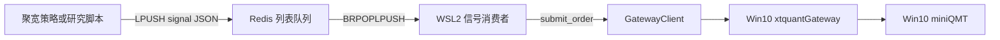

# 四、聚宽数据与桥接

> 本篇合并了 3 份聚宽（JoinQuant）相关文档：JQ 试用期到 QMT 实盘的路线图、数据字典与 API 映射、Redis 信号桥。
> 想复用聚宽的数据或搬入聚宽社区策略时必读。

## 目录

- [1. JQ 试用期到 QMT 实盘路线图](#1-jq-到-qmt-路线图)
- [2. JQ 数据字典与 API 映射](#2-jq-数据字典与-api-映射)
- [3. JQ Redis 信号桥](#3-jq-redis-信号桥)

---

<a id="1-jq-到-qmt-路线图"></a>
# JQ 试用期到 QMT 实盘路线图（恢复版）

## 阶段 A：JQ 试用窗口（策略评估期）

目标：在可用时间窗内尽快筛掉无效策略，固化可用参数。

- 数据侧：
  - 拉取 CSI1000 / 小微盘范围的日线 + 基本面 + 因子快照
  - SQLite 断点续传，避免重复消耗额度
- 研究侧：
  - 先跑 baseline
  - 再做 scan-optimize / iterative-optimize
  - 重点观察：超额收益、最大回撤、稳定性

## 阶段 B：过渡期（模拟+小资金）

- 执行层先用 PaperBroker 验证：
  - TWAP/VWAP
  - 超时撤单+追价
  - 风控触发一致性
- 用小资金验证实盘偏差：
  - 滑点
  - 成交率
  - 实时风险响应

## 阶段 C：QMT 正式实盘（持续评估）

- QMT 成为行情+交易主链路。
- 每日把交易与行情增量落地 SQLite：
  - 持仓变化
  - 成交明细
  - 执行偏差
- 周期性复评：
  - 回测+实盘一致性对比
  - 参数是否漂移
  - 是否需要降仓/切换策略

## 关键原则

- 不追求单次最优参数，追求样本外稳定性。
- 不以高胜率为唯一目标，优先控制回撤和执行风险。
- 数据资产持续沉淀，形成策略迭代护城河。

---

<a id="2-jq-数据字典与-api-映射"></a>

# 聚宽（JQ）SQLite 数据字典与 API 映射

本文档说明本地 SQLite 行情库中每张核心表的含义，以及它们分别对应哪些聚宽 JQData API。

参考文档：[聚宽 JQData API](https://www.joinquant.com/help/api/doc?name=JQDatadoc&id=9842)

## 当前使用的数据库

- `data/market_cache_csi1000_1y.db`
- `data/market_cache_csi2000_1y.db`

两者均由 `scripts/jq_bulk_sync_smallcap.py` 维护。

## 表级映射

- `prices_daily`
  - 用途：每只股票的日 OHLCV 与关键盘面字段。
  - 关键列：`code`、`date`、`open`、`high`、`low`、`close`、`volume`、`money`、`paused`、`high_limit`、`low_limit`、`avg`、`pre_close`
  - 主键：`(code, date)`
  - 数据源 API：`jqdatasdk.get_price(...)`，`frequency="daily"`。

- `index_members`
  - 用途：同步日的指数成分股快照。
  - 关键列：`index_code`、`date`、`code`
  - 主键：`(index_code, date, code)`
  - 数据源 API：`jqdatasdk.get_index_stocks(index_code, date=...)`

- `fundamentals_snapshot`
  - 用途：按日期与股票的估值/基本面快照。
  - 关键列：`date`、`code`、`pe_ratio`、`pb_ratio`、`turnover_ratio`
  - 主键：`(date, code)`
  - 数据源 API：`jqdatasdk.get_fundamentals(query(...), date=...)`，取 `valuation.*` 字段。

- `factors_snapshot`
  - 用途：用于截面打分的紧凑因子快照。
  - 关键列：`date`、`code`、`roe`、`market_cap`、`pe_ratio`、`pb_ratio`、`turnover_ratio`
  - 主键：`(date, code)`
  - 数据源 API：`jqdatasdk.get_fundamentals(query(...), date=...)`，取 `valuation.*` 与 `indicator.roe`。

- `sync_progress`
  - 用途：日线行情增量同步的断点记录。
  - 关键列：`code`、`next_date`、`done`、`updated_at`、`last_error`
  - 使用方式：避免对已完成的价格区间重复拉取。

- `snapshot_progress`
  - 用途：按交易日进行快照同步的断点记录。
  - 关键列：`date`、`done`、`updated_at`、`last_error`、`rows_fundamentals`、`rows_factors`
  - 使用方式：只重试未完成的日期，已完成日期直接跳过。

- `meta`
  - 用途：数据库与同步范围的轻量元信息。
  - 关键列：`key`、`value`（迁移后的表结构会附带 `updated_at`）
  - 常见 key：`index_code`、`start_date`、`end_date`

## 为什么会出现 `snapshot_left=0` 但 `snapshot_incomplete_dates>0`

当所有计划中的日期都已经处理完毕（`done=1`），但上游返回的股票数量少于 `prices_daily` 中该日期的成分数量时（例如 999 vs 1000），就会出现这种情况：

- 流水线状态是“所有日期已完成”。
- 覆盖度仍然不完整，原因来自数据源侧的差异。

这是正常情况，不代表本地同步失败。

## 增量同步机制（无重复拉取）

- 价格路径：
  - 由 `sync_progress.next_date` 与 `done` 控制。
  - 已完成的 code/日期区间会被跳过。

- 快照路径：
  - 由 `snapshot_progress.done` 控制。
  - `scripts/prepare_snapshot_retry.py` 可以选择性地把未完成的日期重置为 `done=0` 来重试。

## 当前同步概况（最近一次）

- CSI1000：`sync_left_price=0`，`snapshot_left=0`
- CSI2000：`sync_left_price=0`，`snapshot_left=0`
- 剩余的 `snapshot_incomplete_dates` 表示的是数据源侧当日覆盖不全，而不是本地任务遗漏。

---

<a id="3-jq-redis-信号桥"></a>

# 聚宽 Redis 信号桥

## 目的

这个桥接层让聚宽（JoinQuant）上的策略把低频的下单意图写入 Redis 队列，本地 `quant` 系统消费这些意图，再通过 `xtquant_gateway` / miniQMT 落地为真实委托。

推荐使用场景：

- 日频或准日频调仓
- 对分钟级模拟盘延迟有容忍度的低频决策

**不适合高频执行。**

## 涉及文件

- 聚宽策略侧信号模式脚本：
  - `test/jq_c1_smallcap_etf_combo.py`
- 信号数据结构定义：
  - `quant/bridge/jq_signal.py`
- 本地消费者：
  - `scripts/jq_signal_consumer.py`
- 已有的执行网关：
  - `quant/gateway/client.py`
  - `scripts/run_xtquant_gateway.py`

## 架构



## 聚宽侧

### 1. 把策略切到信号模式

在 `test/jq_c1_smallcap_etf_combo.py` 里：

```python
EXEC_MODE = "redis_signal"
```

### 2. 配置 Redis 队列

```python
SIGNAL_QUEUE_CONFIG = {
    "host": "your-redis-host",
    "port": 6379,
    "password": "your-password",
    "db": 0,
    "queue_key": "jq:signals",
    "use_tls": True,
    "timeout_sec": 5,
    "stale_after_sec": 900,
    "price_mode": "latest",
    "hmac_secret": "",
    "strategy_name": "c1_smallcap_etf_combo",
}
```

说明：

- 该策略现在会从聚宽研究环境导入 `jq_research_redis_common.py`。
- `jq_research_redis_common.py` 依赖 `redis-py`，运行 `redis_signal` 模式前必须在研究环境里先装好。
- `price_mode`：
  - `latest`：本地消费者以 `price_type=latest` 下单
  - `limit_last`：本地消费者以 `price_type=limit` 下单，限价取最新报价
- `hmac_secret`：
  - 可选但强烈推荐
  - 消费者侧必须传入相同的 `--hmac-secret`（或环境变量 `JQ_SIGNAL_HMAC_SECRET`）

## 信号消息结构

队列消息是 JSON，字段如下：

```json
{
  "schema_version": "v1",
  "source": "joinquant",
  "strategy_name": "c1_smallcap_etf_combo",
  "leg_name": "c1",
  "action": "target_value",
  "code": "000001.XSHE",
  "target_value": 25000.0,
  "generated_at": "2026-04-12T08:00:00+00:00",
  "bar_time": "2026-04-12T10:35:00",
  "client_order_id": "jq-c1-xxxxxxxxxxxxxxxx",
  "price_mode": "latest",
  "note": "rebalance target value",
  "signature": "hmac_sha256_hex"
}
```

### 字段含义

- `action`：目前只支持 `target_value`
- `target_value`：该腿在该标的上的目标名义敞口
- `client_order_id`：幂等键
- `generated_at`：用于过期信号拒收
- `signature`：可选的 HMAC-SHA256 校验签名

## 本地消费者

### 先启动网关

例如：

```bash
uv run python scripts/run_xtquant_gateway.py
```

或在 Windows 侧沿用你已有的 miniQMT 启动流程。

### 启动消费者

```bash
uv run python scripts/jq_signal_consumer.py \
  --config config/live_qmt_http.toml \
  --redis-url "redis://:password@host:6379/0" \
  --queue-key "jq:signals" \
  --hmac-secret "$JQ_SIGNAL_HMAC_SECRET"
```

试运行（不真正下单）：

```bash
uv run python scripts/jq_signal_consumer.py \
  --config config/live_qmt_http.toml \
  --redis-url "redis://:password@host:6379/0" \
  --queue-key "jq:signals" \
  --dry-run
```

## 消费者行为

- 使用 `BRPOPLPUSH` 从 Redis 列表读取
- 使用处理中列表模拟基本的 ack 语义
- 拒收过期消息（`--stale-after-sec`）
- 如果传入 `--hmac-secret`，则校验 HMAC 签名
- 二级去重：
  - `processed:{client_order_id}`：最终幂等标记
  - `inflight:{client_order_id}`：并发中锁
- 只有处理成功（或明确 no-op）后才写 `processed`，不会在提交前写
- 失败消息重试至 `--max-retries` 后进入死信
- 把 `target_value` 换算成目标数量时会用到：
  - 网关行情
  - 当前持仓
  - 手数取整
- 用差量数量通过 `GatewayClient.submit_order()` 下单
- 失败的消息进入死信队列：
  - `jq:signals:dead`

## 数量换算逻辑

对每条信号：

1. 从网关取账户/持仓/行情
2. 由 `target_value` 计算目标数量
3. 对比当前数量
4. 得出差量数量
5. 提交：
   - 差量 > 0：`buy`
   - 差量 < 0：`sell`

以下情况不发单：

- 信号过期
- 信号重复
- 差量为 0

## 已知限制

- 聚宽模拟盘会有延迟，社区常见建议是留 2 分钟左右的分钟数据缓冲，因此本桥更适合低频用法。
- 队列消息表示目标名义敞口，不保证成交。
- 本地实际持仓因拒单或部分成交，可能与聚宽内部“目标持仓”漂移。
- 首版不把执行结果回写到聚宽端。
- 首版不在消费者侧做 TWAP/VWAP 切片。

## 当前部署拓扑

推荐并正在使用的分工：

- `Win10`：运行 miniQMT + xtquant + `xtquant_gateway`
- `WSL2`：运行本仓库（`scripts/jq_signal_consumer.py`、实盘守护、研究助手）
- 聚宽：向 Redis 发信号（策略模式或研究环境助手）

参考：

- [聚宽 API 文档](https://www.joinquant.com/help/api/help#name:api)
- [请问带 V 的各位，聚宽会员的实时模拟会有延迟吗](https://www.joinquant.com/community/post/detailMobile?postId=62716)
- [实盘跟模拟回测收益差多少？](https://www.joinquant.com/community/post/detailMobile?page=3&postId=56740)

## 首次上线建议

1. 先保持 `EXEC_MODE = "direct_jq_order"` 做基线验证
2. 再切到 `redis_signal`
3. 消费者先 `--dry-run`
4. 校验行情、数量、方向是否合理
5. 再切到真实下单

## 未来改进

- 增加回调 sink，把成交/订单状态写回 Redis
- 支持 `target_pct` 消息
- 按策略/账户分开的队列 key
- 若不希望 Redis 直接暴露，可以加一层轻量 HTTP 接入服务
