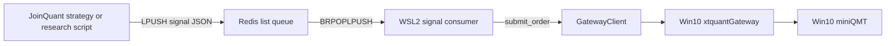

# Part 4: JoinQuant Data and Bridging

> This part merges four JoinQuant-related documents: the roadmap from the JQ trial period to QMT live trading, the data dictionary and API mapping, the Redis signal bridge, and the timing of platform callbacks.
> Required reading when reusing JoinQuant data or porting JoinQuant community strategies.

## Table of Contents

- [1. JQ Trial Period to QMT Live Trading Roadmap](#jq-trial-period-to-qmt-live-trading-roadmap-recovered-version)
- [2. JQ Data Dictionary and API Mapping](#joinquant-jq-sqlite-data-dictionary-and-api-mapping)
- [3. JQ Redis Signal Bridge](#joinquant-redis-signal-bridge)
- [4. JoinQuant Callback Timing and Lifecycle](#joinquant-callback-timing-and-lifecycle)

---

# JQ Trial Period to QMT Live Trading Roadmap (Recovered Version)

## Phase A: JQ Trial Window (Strategy Evaluation Period)

Goal: within the available time window, quickly screen out ineffective strategies and lock in usable parameters.

- Data side:
  - Pull daily bars + fundamentals + factor snapshots for the CSI1000 / micro-cap universe
  - SQLite checkpoint-and-resume, to avoid repeatedly consuming quota
- Research side:
  - Run the baseline first
  - Then run scan-optimize / iterative-optimize
  - Key metrics to watch: excess return, maximum drawdown, stability

## Phase B: Transition Period (Simulation + Small Capital)

- Validate the execution layer with PaperBroker first:
  - TWAP/VWAP
  - Cancel on timeout + chase the price
  - Consistency of risk-control triggers
- Use small capital to validate live-trading deviation:
  - Slippage
  - Fill rate
  - Real-time risk response


## Phase C: Formal QMT Live Trading (Ongoing Evaluation)

- QMT becomes the primary market-data + trading path.
- Persist incremental trading and market data to SQLite every day:
  - Holdings changes
  - Fill details
  - Execution deviation
- Periodic re-evaluation:
  - Backtest vs. live-trading consistency comparison
  - Whether parameters have drifted
  - Whether to reduce position size / switch strategies


## Key Principles

- Do not chase the best parameters of a single run; pursue out-of-sample stability.
- Do not treat a high win rate as the only goal; prioritize controlling drawdown and execution risk.
- Keep accumulating data assets to build a moat for strategy iteration.

---


# JoinQuant (JQ) SQLite Data Dictionary and API Mapping

This document explains what each core table in the local SQLite market database means, and which JoinQuant JQData APIs each one maps to.

Reference: [JoinQuant JQData API](https://www.joinquant.com/help/api/doc?name=JQDatadoc&id=9842)

## Databases Currently in Use

- `data/market_cache_csi1000_1y.db`
- `data/market_cache_csi2000_1y.db`

Both are maintained by `scripts/jq_bulk_sync_smallcap.py`.

## Table-Level Mapping

- `prices_daily`
  - Purpose: daily OHLCV and key market fields for each stock.
  - Key columns: `code`, `date`, `open`, `high`, `low`, `close`, `volume`, `money`, `paused`, `high_limit`, `low_limit`, `avg`, `pre_close`
  - Primary key: `(code, date)`
  - Source API: `jqdatasdk.get_price(...)`, `frequency="daily"`.
- `index_members`
  - Purpose: snapshot of index constituents on the sync date.
  - Key columns: `index_code`, `date`, `code`
  - Primary key: `(index_code, date, code)`
  - Source API: `jqdatasdk.get_index_stocks(index_code, date=...)`
- `fundamentals_snapshot`
  - Purpose: valuation/fundamentals snapshot by date and stock.
  - Key columns: `date`, `code`, `pe_ratio`, `pb_ratio`, `turnover_ratio`
  - Primary key: `(date, code)`
  - Source API: `jqdatasdk.get_fundamentals(query(...), date=...)`, taking the `valuation.*` fields.
- `factors_snapshot`
  - Purpose: compact factor snapshot used for cross-sectional scoring.
  - Key columns: `date`, `code`, `roe`, `market_cap`, `pe_ratio`, `pb_ratio`, `turnover_ratio`
  - Primary key: `(date, code)`
  - Source API: `jqdatasdk.get_fundamentals(query(...), date=...)`, taking `valuation.*` and `indicator.roe`.
- `sync_progress`
  - Purpose: checkpoint records for incremental daily-bar sync.
  - Key columns: `code`, `next_date`, `done`, `updated_at`, `last_error`
  - Usage: avoids re-fetching price ranges that are already done.
- `snapshot_progress`
  - Purpose: checkpoint records for per-trading-day snapshot sync.
  - Key columns: `date`, `done`, `updated_at`, `last_error`, `rows_fundamentals`, `rows_factors`
  - Usage: only retry unfinished dates; finished dates are skipped directly.
- `meta`
  - Purpose: lightweight metadata about the database and the sync range.
  - Key columns: `key`, `value` (the migrated table schema also carries `updated_at`)
  - Common keys: `index_code`, `start_date`, `end_date`


## Why `snapshot_left=0` Can Coexist with `snapshot_incomplete_dates>0`

This happens when all planned dates have been processed (`done=1`), but the number of stocks returned upstream is smaller than the number of constituents on that date in `prices_daily` (e.g. 999 vs 1000):

- The pipeline status is "all dates done".
- Coverage is still incomplete, because of differences on the data-source side.

This is normal and does not mean the local sync failed.

## Incremental Sync Mechanism (No Repeated Fetching)

- Price path:
  - Controlled by `sync_progress.next_date` and `done`.
  - Completed code/date ranges are skipped.
- Snapshot path:
  - Controlled by `snapshot_progress.done`.
  - `scripts/prepare_snapshot_retry.py` can selectively reset unfinished dates to `done=0` to retry them.


## Current Sync Status (Latest Run)

- CSI1000: `sync_left_price=0`, `snapshot_left=0`
- CSI2000: `sync_left_price=0`, `snapshot_left=0`
- The remaining `snapshot_incomplete_dates` indicate incomplete same-day coverage on the data-source side, not tasks missed locally.

---


# JoinQuant Redis Signal Bridge


## Purpose

This bridge lets strategies on JoinQuant write low-frequency order intents into a Redis queue; the local `quant` system consumes those intents and turns them into real orders through `xtquant_gateway` / miniQMT.

Recommended use cases:

- Daily or near-daily rebalancing
- Low-frequency decisions that can tolerate minute-level paper-trading latency

**Not suitable for high-frequency execution.**

## Files Involved

- JoinQuant strategy-side signal-mode script:
  - `test/jq_c1_smallcap_etf_combo.py`
- Signal data structure definition:
  - `quant/bridge/jq_signal.py`
- Local consumer:
  - `scripts/jq_signal_consumer.py`
- Existing execution gateway:
  - `quant/gateway/client.py`
  - `scripts/run_xtquant_gateway.py`


## Architecture




## JoinQuant Side


### 1. Switch the Strategy to Signal Mode

In `test/jq_c1_smallcap_etf_combo.py`:

```python
EXEC_MODE = "redis_signal"
```


### 2. Configure the Redis Queue

```python
SIGNAL_QUEUE_CONFIG = {
    "host": "your-redis-host",
    "port": 6379,
    "password": "your-password",
    "db": 0,
    "queue_key": "jq:signals",
    "use_tls": True,
    "timeout_sec": 5,
    "stale_after_sec": 900,
    "price_mode": "latest",
    "hmac_secret": "",
    "strategy_name": "c1_smallcap_etf_combo",
}
```

Notes:

- The strategy now imports `jq_research_redis_common.py` from the JoinQuant research environment.
- `jq_research_redis_common.py` depends on `redis-py`, which must be installed in the research environment before running in `redis_signal` mode.
- `price_mode`:
  - `latest`: the local consumer places orders with `price_type=latest`
  - `limit_last`: the local consumer places orders with `price_type=limit`, with the limit price taken from the latest quote
- `hmac_secret`:
  - Optional but strongly recommended
  - The consumer side must be given the same `--hmac-secret` (or the environment variable `JQ_SIGNAL_HMAC_SECRET`)


## Signal Message Format

Queue messages are JSON with the following fields:

```json
{
  "schema_version": "v1",
  "source": "joinquant",
  "strategy_name": "c1_smallcap_etf_combo",
  "leg_name": "c1",
  "action": "target_value",
  "code": "000001.XSHE",
  "target_value": 25000.0,
  "generated_at": "2026-04-12T08:00:00+00:00",
  "bar_time": "2026-04-12T10:35:00",
  "client_order_id": "jq-c1-xxxxxxxxxxxxxxxx",
  "price_mode": "latest",
  "note": "rebalance target value",
  "signature": "hmac_sha256_hex"
}
```


### Field Meanings

- `action`: currently only `target_value` is supported
- `target_value`: the target notional exposure of this leg on this instrument
- `client_order_id`: idempotency key
- `generated_at`: used to reject stale signals
- `signature`: optional HMAC-SHA256 signature


## Local Consumer


### Start the Gateway First

For example:

```bash
uv run python scripts/run_xtquant_gateway.py
```

Or reuse your existing miniQMT startup procedure on the Windows side.

### Start the Consumer

```bash
uv run python scripts/jq_signal_consumer.py \
  --config config/live_qmt_http.toml \
  --redis-url "redis://:password@host:6379/0" \
  --queue-key "jq:signals" \
  --hmac-secret "$JQ_SIGNAL_HMAC_SECRET"
```

Dry run (no real orders placed):

```bash
uv run python scripts/jq_signal_consumer.py \
  --config config/live_qmt_http.toml \
  --redis-url "redis://:password@host:6379/0" \
  --queue-key "jq:signals" \
  --dry-run
```


## Consumer Behavior

- Reads from the Redis list using `BRPOPLPUSH`
- Uses a processing list to emulate basic ack semantics
- Rejects stale messages (`--stale-after-sec`)
- Verifies the HMAC signature if `--hmac-secret` is given
- Two-level deduplication:
  - `processed:{client_order_id}`: the final idempotency marker
  - `inflight:{client_order_id}`: the in-flight concurrency lock
- `processed` is written only after processing succeeds (or is an explicit no-op), never before submission
- Failed messages are retried up to `--max-retries` and then moved to the dead-letter queue
- Converting `target_value` into a target quantity uses:
  - Gateway quotes
  - Current holdings
  - Lot-size rounding
- Places orders via `GatewayClient.submit_order()` using the delta quantity
- Failed messages go to the dead-letter queue:
  - `jq:signals:dead`


## Quantity Conversion Logic

For each signal:

1. Fetch the account/holdings/quotes from the gateway
2. Compute the target quantity from `target_value`
3. Compare with the current quantity
4. Derive the delta quantity
5. Submit:
  - delta > 0: `buy`
  - delta < 0: `sell`

No order is placed in these cases:

- The signal is stale
- The signal is a duplicate
- The delta is 0


## Known Limitations

- JoinQuant paper trading has latency; a common community recommendation is to leave about 2 minutes of minute-data buffer, so this bridge is better suited to low-frequency use.
- A queue message expresses a target notional exposure and does not guarantee a fill.
- Actual local holdings may drift from JoinQuant's internal "target holdings" because of rejected orders or partial fills.
- The first version does not write execution results back to the JoinQuant side.
- The first version does not do TWAP/VWAP slicing on the consumer side.


## Current Deployment Topology

Recommended and currently used division of labor:

- `Win10`: runs miniQMT + xtquant + `xtquant_gateway`
- `WSL2`: runs this repo (`scripts/jq_signal_consumer.py`, the live daemon, research helpers)
- JoinQuant: sends signals to Redis (strategy mode or research-environment helper)

References:

- [JoinQuant API Docs](https://www.joinquant.com/help/api/help#name:api)
- [Question for those with a V badge: does JoinQuant members' real-time paper trading have latency?](https://www.joinquant.com/community/post/detailMobile?postId=62716)
- [How much does live-trading return differ from simulated backtest return?](https://www.joinquant.com/community/post/detailMobile?page=3&postId=56740)


## First-Launch Recommendations

1. First keep `EXEC_MODE = "direct_jq_order"` for baseline validation
2. Then switch to `redis_signal`
3. Have the consumer run with `--dry-run` first
4. Check that quotes, quantities and directions look reasonable
5. Then switch to real order placement


## Future Improvements

- Add a callback sink that writes fill/order status back to Redis
- Support `target_pct` messages
- Separate queue keys per strategy/account
- If you do not want Redis exposed directly, add a lightweight HTTP ingestion service

---


# JoinQuant Callback Timing and Lifecycle

> All JoinQuant strategy callbacks, run_daily scheduling, and context contents are managed by the JoinQuant engine (jqboson). Not understanding the lifecycle is one of the easiest pitfalls (e.g. `initialize` runs only once in paper trading, so old values on `g.` are not refreshed automatically after you change the code).


## 4.1 Callback Overview

Ordered by call frequency.


| Callback                            | Type           | Trigger timing                                                                          | Times per day            |
| ----------------------------------- | ---- | ----------------------------- | -------- |
| `initialize(context)`               | One-off        | When the strategy is **first** created (every backtest run; only at creation for paper/live trading) | 0 or 1                   |
| `process_initialize(context)`       | Process-level  | Every process start (including daily restarts)                                          | Once per restart         |
| `after_code_changed(context)`       | Code-level     | Reload after the code is modified (including before every backtest run)                 | When code is modified    |
| `before_trading_start(context)`     | Daily pre-market  | Before 09:00 on each trading day                                                     | 1                        |
| `handle_data(context, data)`        | Minute-level   | Every bar (minute or daily)                                                             | 240 (minute frequency)   |
| `after_trading_end(context)`        | Daily post-market | After 15:30 on each trading day                                                      | 1                        |
| `on_strategy_end(context)`          | Strategy end   | When a backtest/paper-trading/live-trading run ends                                     | 0 or 1                   |
| `run_daily(fn, time='HH:MM')`       | Scheduled task | At the specified time on each trading day                                               | Depends on number hooked |
| `run_weekly(fn, weekday, time)`     | Scheduled task | On the specified weekday each week                                                      | ≤ 1                      |
| `run_monthly(fn, day, time)`        | Scheduled task | On the specified day each month                                                         | ≤ 1                      |
| `on_order_response(context, order)` | Event-driven   | Order status change (submitted/filled/canceled/rejected)                                | Depends on number of orders |
| `on_trade_response(context, trade)` | Event-driven   | Every fill                                                                              | Depends on number of fills  |


## 4.2 Lifecycle Timeline


### Scenario A: Backtest (every run is a full lifecycle)

```
[Strategy start]
├─ initialize(context)               ← once
├─ after_code_changed(context)       ← once (also runs in backtests)
│
├─ Per-trading-day loop:
│   ├─ before_trading_start(context) ← once pre-market
│   ├─ 09:30 market open
│   ├─ handle_data / run_daily hooked functions (in time order)
│   ├─ 15:00 market close
│   └─ after_trading_end(context)    ← once post-market
│
└─ Backtest ends
    └─ on_strategy_end(context)      ← once
```


### Scenario B: Paper Trading / Live Trading (initial creation)

```
[Strategy first created]
├─ initialize(context)               ← once (only once in its entire life!)
├─ process_initialize(context)       ← once
├─ after_code_changed(context)       ← once
│
├─ Per-trading-day loop (same as backtest)
│
└─ ... (keeps running until manually stopped)
```


### Scenario C: Paper Trading / Live Trading (restart the next day)

```
[Process restart (every trading-day morning)]
├─ process_initialize(context)       ← once per restart
│  └── (initialize **will not run again**; g. is restored from pickle)
│
└─ Continue the per-trading-day loop
```


### Scenario D: Paper Trading / Live Trading (after a code change)

```
[Code saved → JoinQuant hot reload]
├─ after_code_changed(context)       ← once per code change
│  └── (initialize does not re-run either; only source-level def changes take effect)
│
└─ Continue the per-trading-day loop
```


## 4.3 Key Pitfalls & Best Practices


### Pitfall 1: `initialize` Runs Only Once (Paper/Live Trading)

**Problem**: if you write this in `initialize`:

```python
def initialize(context):
    g.stop_loss_pct = 0.15      # assigned only once in its entire life
```

You change the top-level constant `STOP_LOSS_PCT` to `0.08` and restart the strategy, but `g.stop_loss_pct` is **still 0.15** — because `initialize` does not re-run, and `g.` is restored from pickle with the old value.

**Fix**: also push sensitive parameters in `after_code_changed`:

```python
def after_code_changed(context):
    g.stop_loss_pct = STOP_LOSS_PCT   # the module-level constant is the source of truth
    # re-register run_daily schedules here as well
```


### Pitfall 2: Functions Hooked by `run_daily` Must Be Picklable (Module-Level Functions)

**Problem**: JoinQuant's `run_daily` performs a serialization check, and **bound methods / lambdas / closures are all rejected**:

```python
# ❌ raises InvalidHandle: not serializable
class MyStrategy:
    def daily_check(self, context): ...

def initialize(context):
    strat = MyStrategy()
    run_daily(strat.daily_check, time='09:35')
```

**Fix**: define a module-level `def`, then look up the instance inside the function:

```python
_strategy = None

def _daily_check_dispatch(context):
    _strategy.daily_check(context)

def initialize(context):
    global _strategy
    _strategy = MyStrategy()
    run_daily(_daily_check_dispatch, time='09:35')
```


### Pitfall 3: `run_daily(fn, time='every_bar')` vs `handle_data`

**Both fire every minute** (provided it is a **minute-frequency backtest**); the differences:


| Behavior              | `run_daily(..., time='every_bar')` | `handle_data(context, data)`       |
| ------ | ---------------------------------- | ---------------------------------- |
| Signature             | `fn(context)`                      | `fn(context, data)`                |
| Scheduling order      | Sorted by time together with the other run_daily jobs | Called independently, usually last |
| Use                   | Minute-level stop-loss / risk control (no data object needed) | When you need access to `data[security].last_price` etc. |


**Recommendation**: prefer `run_daily(..., time='every_bar')`, which unifies the code path (all scheduling is hooked via run_daily).

### Pitfall 4: `context.run_params.type` Distinguishes Backtest / Paper / Live Trading

```python
def initialize(context):
    mode = getattr(context.run_params, 'type', 'backtest')
    # 'backtest' / 'sim_trade' / 'live_trade'
    if mode == 'backtest':
        log.info("Backtest mode; logs will be written to wufu_run.backtest.log")
```

Use it to add a suffix to log files and to separate live-trading from backtest behavior (e.g. disable certain development logs in live trading).

### Pitfall 5: `context.previous_date` vs `context.current_dt` in Backtests

- `context.previous_date` = the date of the previous **trading day** (`datetime.date` type)
- `context.current_dt`    = the time of the current bar (`datetime.datetime` type)

**To avoid look-ahead bias in backtests**, always pull data with `previous_date`:

```python
set_option("avoid_future_data", True)   # enable in initialize to prevent accidental use of future data

df = get_price(code, end_date=context.previous_date, count=20, ...)  # ✅ safe
df = get_price(code, end_date=context.current_dt, count=20, ...)     # ⚠️ in minute-frequency, the current day's bar may be included
```

## 4.4 Context Information

```
context
├── current_dt          # datetime, logical time of the current bar (e.g. 09:35)
├── previous_date       # date, previous trading day (commonly used for stock selection / financials)
├── universe            # stock universe set by set_universe
├── run_params
│   ├── start_date / end_date
│   ├── type            # simple_backtest | full_backtest | sim_trade
│   └── frequency       # day | minute | tick
├── portfolio           # overall account (= subportfolios[0] for a single account)
│   ├── total_value / available_cash / cash
│   ├── positions_value / returns / starting_cash
│   ├── positions       # dict, same as long_positions
│   └── long_positions / short_positions
└── subportfolios[]     # multiple sub-accounts (stocks/futures/margin trading)
    ├── available_cash / total_value
    └── long_positions[code] → Position
```

## 4.5 Typical Strategy Skeleton

Combining the pitfalls above, a minimal "pitfall-proof" strategy skeleton:

```python
# ============ Top-level constants (the only place to change parameters) ============
STOP_LOSS_PCT   = 0.15
SELL_PROFIT_PCT = 0.03


# ============ Lifecycle callbacks ============

def initialize(context):
    """Runs only once in its lifetime (runs on every backtest run; in paper trading only at creation)."""
    set_option("avoid_future_data", True)
    set_option("use_real_price", True)
    set_slippage(PriceRelatedSlippage(0.0001), type="fund")
    set_order_cost(OrderCost(..., min_commission=5), type="fund")
    log.set_level('order', 'error')

    # Initial state on first creation
    g.holdings = []
    _apply_config_to_g()          # push the top-level constants into g


def process_initialize(context):
    """Runs on every process start (including daily restarts)."""
    # Fallback: if g.holdings got lost for some reason, restore the default
    if not hasattr(g, 'holdings') or g.holdings is None:
        g.holdings = []


def after_code_changed(context):
    """Runs after every code change (hot update in paper/live trading; also runs on every backtest)."""
    _apply_config_to_g()          # key: make the new parameters take effect after a code change
    unschedule_all()
    run_daily(morning_check,   time='09:35')
    run_daily(afternoon_trade, time='13:10')
    run_daily(flush_daily_log, time='15:20')


def on_strategy_end(context):
    """Callback when a backtest / paper-trading / live-trading run ends."""
    log.info("Strategy ended, final net value = ...")


# ============ Helpers (picklable module-level functions) ============

def _apply_config_to_g():
    """Push the top-level constants into g so new parameters take effect after a code change."""
    g.stop_loss_pct   = STOP_LOSS_PCT
    g.sell_profit_pct = SELL_PROFIT_PCT


def morning_check(context):
    """Function hooked by run_daily at 09:35. Must be a module-level free function."""
    ...


def afternoon_trade(context):
    ...


def flush_daily_log(context):
    ...
```


## 4.5 References

- [JoinQuant API Docs · Lifecycle Callbacks](https://www.joinquant.com/help/api/help?name=api#name:-%E7%AD%96%E7%95%A5%E7%9B%B8%E5%85%B3%E5%87%BD%E6%95%B0)
- [JoinQuant API Docs · run_daily / run_weekly / run_monthly](https://www.joinquant.com/help/api/help?name=api#name:%E5%AE%9A%E6%97%B6%E8%BF%90%E8%A1%8C%E5%87%BD%E6%95%B0)
- [JoinQuant · Note on Strategy Code Updates Not Taking Effect](https://www.joinquant.com/view/community/detail/13123)
- Hands-on notes: `docs/08_wufu_strategy.md` §6 (the daily scheduling timeline)

