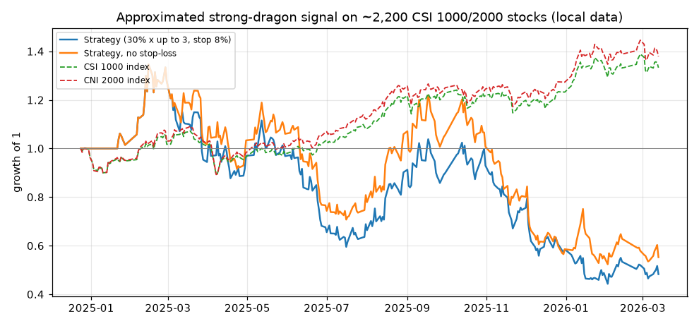

# Strong Dragon deck study: what it claims, what the data says, and a JoinQuant script

Source: `强龙出现运营方案.pptx` at the repo root (41 slides, 18.7 MB, not committed). It is the sales and
operations deck of a closed-source chart indicator called `强龙出现` ("Strong Dragon Appears", the label of the
indicator's sub-chart in every screenshot), sold by a "dragon-head" (sector-leader momentum) trading team.

Status: research only, MVP, unverified on JoinQuant itself. Nothing here is a production strategy.
A Chinese companion with plain-language explanations of every term is in [`README.zh.md`](README.zh.md).

## TL;DR

- The deck's case returns are real but hand-picked: 19 of its 21 claims reproduce within 10 percentage points
  (16 within 1 point) as "close before the start date to the close N trading days later". Each window starts
  just before a limit-up run and ends near the top, i.e. it is chosen in hindsight. Three slides have wrong
  end dates, and one (c06) has the wrong year and a "two waves, +110%" claim that cannot be reproduced.
- The indicator can be approximated from the screenshots with two rules (red ≈ main up-wave, green ≈ up-wave over):
  they find 78% of the red bars (68% of the rule's red days are right) and about 62% of the green bars.
- On the deck's own winners that rule captures +112% per case on average, but 7 of the 21 runs (including
  the +659% and +386% headline cases) could not be bought at all: the stock opened at limit-up the day after the signal.
- On every stock instead of the winners (2,189 CSI 1000 / CSI 2000 names, 2025-01 to 2026-03), the same rule
  fires ~640 times a month, wins 32% of the time and loses 0.4% per trade on average. With the deck's
  sizing (30% per stock, up to 3 stocks) the portfolio lost 52% while CSI 1000 gained 33%.
- "Manual picking" (hot industry + its leader) and three further ideas of ours (a market-mood filter, a wider
  exit, buying the first pullback) were tested out-of-sample: some look good on Jan-Aug 2025, none survives
  Sep 2025-Mar 2026, and passive index exposure beat every variant in both periods.
- The second guess, "they pick by news or theme", was tested on 317,390 company announcements and 330 concept
  boards: signals with a catalyst or in a hot concept also fail out of sample. Only 4 of the 21 deck winners had a
  company catalyst before the move; the rest started on industry or policy news that no announcement contains.
- A third guess, "buy the first limit-up of a brand-new theme", has only 4 months of usable history (44 events):
  no edge is visible, and buying any limit-up stock the next morning trailed the index. A daily news / theme archive
  now runs on the home node so that this can be tested properly later.
- The deck's return arithmetic does not follow from its own assumptions and assumes every trade wins 30%.

## How to read this document

Sections 1-4 answer "is the deck right?", section 5 answers "does manual stock picking fix it?" (5: industry
and leader, 5.1: news and concept catalysts, 5.2: new-theme limit-ups),
section 6 is the JoinQuant script, section 7 the CI job, sections 8-9 how to reproduce. Every number comes from
the scripts in this folder; the glossary at the end explains the trading and statistics terms.

## 1. What the deck says

| Slides | Content |
|---|---|
| 1-5 | Product: "Strong Dragon Appears analysis assistant". Motto: only trade the main up-wave, never guess tops, never trade ranges. Built to unify the team's judgment and discipline; pain points: stuck at the top, selling before the run, repeated stop-outs. |
| 6-8 | Four pillars: core conditions from experience, blend of technical analysis, team consistency, field-tested. Versus ordinary software: a stage signal instead of daily money flow, holding the whole wave instead of trading in and out. |
| 9, 11 | Silan Microelectronics (600460) charts: one from another vendor's software, one with the indicator (2026). |
| 10, 12 | Where it applies: I main up-wave (core), II accumulation before launch (watch only), III high-level chop and IV downtrend (do not trade). Advantages: intuitive, efficient, simple; "30% position, ride the main wave". |
| 13-24, 26-34 | 21 case screenshots, one per month of 2024 and 2025, each with a claimed window and return (table in section 3). |
| 25, 35 | Return arithmetic: 1M CNY, 1-2 stocks a month, 30% per stock, 30% target per stock, "about 1.44x a year at full position", "12 stocks ≈ 244%". |
| 36-41 | Business model: mid tier (< 1M CNY, 3-month trial), high tier (> 1M CNY, yearly fee), premium (team cooperation, lifetime buy-out); on-site installation, 2-3 year update cycle, 10-year cooperation, 3 updates. |

The deck never states the indicator's formula, the exact entry/exit rule, how the team picks the stocks, or a
single losing trade.

## 2. Recovering the signal from the screenshots

`extract_slide_signals.py` reads every case screenshot straight from the pptx, fits an evenly spaced N-bar grid
to the candlestick panel (N is printed on each chart), and samples the sub-chart at each bar for red (+100) and
green (-100) bars. For all 22 charts the number of trading days between the chart's start and end dates equals
N exactly, so every bar maps to a date. Result: `slide_signals.csv`, 1,590 labelled days, 261 red and 234 green.

What the labelled days look like (all 22 charts):

| | Red days | Green days | Other days |
|---|---|---|---|
| Close above MA20 | 100% | 79% | 55% |
| MA5 > MA10 > MA20 | 97% | 57% | 31% |
| Limit-up that day | 43% | 4% | 6% |
| Median daily change | +9.5% | -1.1% | +0.2% |

So red marks a stock in a steep, orderly uptrend (often a limit-up chain); green marks the first weakness after it,
while the price is still high. A rule search on those labels (leave-one-case-out validated, F1 0.71 for red, so not
just fitted to 22 pictures) gives:

| Signal | Rule | Precision | Recall |
|---|---|---|---|
| RED (main up-wave in progress) | MA5 > MA10 > MA20 and close / close 3 bars ago - 1 ≥ 10% | 68% | 78% |
| GREEN (main up-wave over) | a RED in the previous 15 bars, no RED today, close < MA5 | 61% | 63% |

Adding a second strength condition did not help (F1 0.724 vs 0.726), so the simplest rule is kept. This is an
approximation of a closed-source formula, not the formula. All comparisons use a 1e-9 relative tolerance so that
exact ties (e.g. MA10 = MA20 on flat prices) give the same answer on every pandas version.

## 3. Measuring the deck's claims

### 3.1 The 21 case claims

Returns from real daily bars (`measure_cases.py`; Shanghai/Shenzhen forward-adjusted, Beijing unadjusted).
"Close-to-close" = close before the start date to the close of the last day in the written window.

| case | stock | claimed window | claimed days / actual | claimed | close-to-close | to window high | one-word limit-ups |
|---|---|---|---|---|---|---|---|
| c01 | Shenzhonghua A 000017.XSHE | 2024-01-09..01-19 | 9 / 9 | 136% | 136% | 136% | 3 |
| c02 | Kelai Mechatronics 603960.XSHG | 2024-02-08..02-28 | 9 / 9 | 100% | 94% | 135% | 5 |
| c03 | Jindun 300411.XSHE | 2024-03-11..03-17 | 11 / 5 | 70% | 23% (71% over 11 days) | 49% | 0 |
| c04 | Zhengdan 300641.XSHE | 2024-04-11..04-23 | 9 / 9 | 188% | 188% | 235% | 0 |
| c05 | Yingli 300956.XSHE | 2024-05-20..06-03 | 11 / 11 | 160% | 161% | 181% | 0 |
| c06 | Yihao New Materials 301176.XSHE | 2025-06-04..06-19 | 11 / 12 | 110% | 55% | 55% | 0 |
| c07 | Dazhong Transportation 600611.XSHG | 2024-07-09..07-15 | 15 / 5 | 223% | 53% (223% over 15 days) | 59% | 1 |
| c08 | Shenzhen Huaqiang 000062.XSHE | 2024-08-19..09-11 | 15 / 18 | 333% | 255% (333% over 15 days) | 357% | 3 |
| c09 | Yinzhijie 300085.XSHE | 2024-09-20..10-09 | 9 / 9 | 360% | 360% | 360% | 2 |
| c10 | Guangzhi Technology 300489.XSHE | 2024-09-27..10-25 | 11 / 11 | 386% | 387% | 443% | 7 |
| c11 | Richu Dongfang 603366.XSHG | 2024-11-04..11-11 | 6 / 6 | 49% | 49% | 75% | 1 |
| c12 | Runxin Technology 300493.XSHE | 2024-12-11..12-16 | 4 / 4 | 65% | 65% | 87% | 0 |
| c13 | Wanda Bearing 920002.BJ | 2025-02-25..02-28 | 4 / 4 | 77% | 77% | 137% | 0 |
| c14 | Zhongyida 600610.XSHG | 2025-03-17..03-27 | 9 / 9 | 114% | 115% | 115% | 0 |
| c15 | Zhongyou Technology 688648.XSHG | 2025-05-26..05-29 | 4 / 4 | 49% | 49% | 56% | 0 |
| c16 | Beifang Changlong 301357.XSHE | 2025-06-16..06-20 | 5 / 5 | 50% | 39% | 53% | 0 |
| c17 | Shangwei New Materials 688585.XSHG | 2025-06-27..07-23 | 14 / 14 | 659% | 659% | 661% | 9 |
| c18 | Gebijia 920438.BJ | 2025-07-30..08-19 | 15 / 15 | 162% | 161% | 198% | 0 |
| c19 | Shoukai 600376.XSHG | 2025-09-05..09-17 | 9 / 9 | 130% | 130% | 130% | 0 |
| c20 | Guosheng Technology 603778.XSHG | 2025-11-03..11-17 | 11 / 11 | 80% | 74% | 88% | 2 |
| c21 | Tianli Composite 920576.BJ | 2025-12-11..12-19 | 7 / 7 | 139% | 139% | 157% | 0 |

Findings:

- The claims are computed as "close before the start → close N trading days later": 19 of 21 match within 10
  points, 16 within 1 point. c03, c07 and c08 reproduce exactly that way; their written end dates are wrong
  (2024-03-17 is a Sunday). c16 (+50%) only matches the window high (+53%), not a close.
- c06 is labelled June 2024 on the slide but the chart is June 2025, and its "two waves, +110%" is not reproducible
  (one leg measures +55%). Other typos: c15 "May 229", c20 "January 17" for November 17.
- 9 of the 21 windows contain one-word limit-up days (open = high = low = close at the limit), on which nobody can buy.
- Every window starts right before the run and ends near the top. That is only possible in hindsight.

### 3.2 What the approximated rule captures on those same winners

Signal on the close, buy at the next open (skipped if that open is at limit-up), sell at the next open after GREEN
or a close 8% below cost; commission 0.03%, stamp duty 0.05% on sells, slippage 0.1%.

| case | stock | signal | entry | exit | rule return | best price after entry | claimed |
|---|---|---|---|---|---|---|---|
| c03 | Jindun | 2024-03-05 | 2024-03-06 | 2024-03-15 | 49% | 85% | 70% |
| c04 | Zhengdan | 2024-04-10 | 2024-04-11 | 2024-04-26 | 150% | 181% | 188% |
| c05 | Yingli | 2024-05-21 | 2024-05-22 | 2024-06-05 | 61% | 114% | 160% |
| c06 | Yihao New Materials | 2025-06-18 | 2025-06-19 | 2025-06-26 | 4% | 25% | 110% |
| c08 | Shenzhen Huaqiang | 2024-08-15 | 2024-08-16 | 2024-09-11 | 280% | 400% | 333% |
| c09 | Yinzhijie | 2024-09-19 | 2024-09-20 | 2024-10-14 | 166% | 330% | 360% |
| c11 | Richu Dongfang | 2024-11-04 | 2024-11-05 | 2024-12-04 | 258% | 358% | 49% |
| c13 | Wanda Bearing | 2025-02-19 | 2025-02-20 | 2025-03-10 | 104% | 175% | 77% |
| c14 | Zhongyida | 2025-03-12 | 2025-03-13 | 2025-04-02 | 65% | 135% | 114% |
| c15 | Zhongyou Technology | 2025-04-28 | 2025-04-29 | 2025-06-05 | 151% | 187% | 49% |
| c16 | Beifang Changlong | 2025-06-13 | 2025-06-16 | 2025-06-25 | 20% | 51% | 50% |
| c18 | Gebijia | 2025-08-01 | 2025-08-04 | 2025-08-22 | 103% | 172% | 162% |
| c20 | Guosheng Technology | 2025-11-05 | 2025-11-06 | 2025-11-21 | 47% | 88% | 80% |
| c21 | Tianli Composite | 2025-12-10 | 2025-12-11 | 2025-12-23 | 107% | 148% | 139% |

- 14 of the 21 runs are captured, +112% per case on average (claimed average of all 21: +173%).
- The other 7 (c01, c02, c07, c10, c12, c17, c19) could not be bought: the day after the signal opened at limit-up.
  They include the two biggest headlines, c17 (+659%) and c10 (+386%).
- All 33 rule trades inside the 21 case charts (including false starts): mean +49%, median +13%, 67% winners.
  These are stocks already known to be winners, so this is an upper bound, not an expectation.

### 3.3 The deck's return arithmetic (slides 25 and 35)

| Stated assumption | What it actually implies |
|---|---|
| 30% position × 30% gain | +9% of the account per trade |
| 12 trades a year | +108% simple, +181% compounded |
| 1-2 trades a month (24 a year) | +691% compounded |
| "about 1.44x a year at full position" | needs only +3.1% per trade; at full position, 12 × +30% compounds to +2,230% |
| "12 stocks ≈ +244%" | needs +10.8% of the account per trade (a 36% gain per stock at 30% sizing) |

None of the deck's figures follows from its own assumptions, and all of them assume every trade wins 30% with
no losers and no costs. Measured on the whole universe (section 4), 2.2% of signals reach +30%.

## 4. The same rule on the whole universe (no cherry-picking)

`scan_universe.py` runs the rule on every stock of the local SQLite databases
(`data/runtime/market_csi1000_latest.db` + `market_csi2000_latest.db`: 2,189 stocks, 2024-12-24..2026-03-13,
signals start after the 20-bar MA warm-up). Suspended days are skipped. Execution rules as in 3.2; limit-up and
limit-down come from the exchange's daily `high_limit` / `pre_close`, so ST stocks use their 5% limit.

| Measure | Value |
|---|---|
| Fresh RED signals | 9,540 (≈ 640 per month) |
| Event study, every signal traded independently | 8,025 trades (220 unfillable at a limit-up open); win rate 32%; mean -0.4%; median -2.5%; 10th / 90th percentile -8.9% / +9.3%; ≥ +30%: 2.2%; ≤ -10%: 6.8%; average hold 4.1 days |
| Same without the stop-loss | win rate 32%; mean -0.4%; median -2.5% |

Portfolio with the deck's sizing (30% of equity per stock, at most 3 holdings, signals ranked by 3-day return,
minimum 50M CNY average daily trading value):

| Portfolio | Total return | CAGR | Max drawdown | Sharpe | Trades | Win rate |
|---|---|---|---|---|---|---|
| Rule, 8% stop-loss | -51.8% | -45.1% | -67.1% | -0.67 | 200 | 35% |
| Rule, no stop-loss | -44.8% | -38.6% | -61.1% | -0.50 | 185 | 36% |
| Rule, no liquidity filter | -53.4% | -46.7% | -68.3% | -0.72 | 200 | 35% |
| CSI 1000 index | +33.3% | +26.6% | -16.9% | 1.21 | | |
| CNI 2000 index | +37.9% | +30.3% | -18.3% | 1.27 | | |



Interpretation: the indicator describes a main up-wave well after the fact, but bought on the signal it is a
short-term momentum chase whose average trade is slightly negative before any stock-picking skill. The
"1-2 bull stocks a month" exist: about 13 signals a month ended at +30% or more under the rule's own exits, and
about 40 a month rose 30% at some point after entry. Finding them among ~640 signals is the whole problem, and
the deck gives no rule for it.

Limitations: the universe is the CSI 1000 / CSI 2000 members stored locally (no micro-caps outside CSI 2000,
no Beijing Stock Exchange, survivorship bias), the period is 15 months, and the indicator is an approximation.

## 5. Does manual stock picking fix it? (hot industry + its leader)

The team reportedly picks stocks by hand. The natural guess is "find the hot industry, then its leader".
`sector_study.py` turns that into rules with thresholds fixed before looking at results, and tests them, plus
three ideas of our own, separately on two periods: train 2025-01..2025-08 and test 2025-09..2026-03.
Industry = Shenwan level 2 (`industry_sw.csv`, 5,577 stocks, today's snapshot from Sina; 103 industries have
at least 5 members in the universe).

- hot: the stock's industry is among the 5 best by median 5-day return, and at least 2 of its members are RED.
- leader: the stock has the highest 5-day return among the RED members of its industry (at least 2 RED).
- regime (ours): trade only when chasing currently pays, i.e. the previous signals' next-day open-to-close return,
  averaged over 3 days, is positive.
- exit_ma10 (ours): sell on a close below MA10 instead of MA5, to let leaders run.
- hot pullback (ours, registered before running): skip the signal day, buy the first pullback to MA5 within
  5 days while MA5 > MA10 > MA20 still holds; first run with the MA5 exit, then with MA10 because a pullback
  entry sits at MA5 and the MA5 exit fires immediately.

| Variant | Train: trades | mean / median per trade | portfolio | Test: trades | mean / median per trade | portfolio |
|---|---|---|---|---|---|---|
| all signals | 4,587 | -0.1% / -2.2% | -66% | 3,438 | -0.8% / -3.1% | -63% |
| hot | 729 | +0.8% / -2.3% | +8% | 515 | -1.7% / -3.3% | -39% |
| leader | 600 | -1.1% / -3.1% | -36% | 497 | -1.0% / -3.5% | -53% |
| hot + leader | 72 | -0.1% / -3.8% | +17% | 70 | -1.9% / -4.3% | -40% |
| regime | 3,571 | +0.1% / -2.1% | -28% | 2,356 | -1.0% / -3.3% | -53% |
| hot + leader + regime | 52 | +0.5% / -3.8% | +27% | 46 | -2.9% / -5.0% | -25% |
| hot + leader, exit_ma10 | 72 | +1.7% / -5.0% | +54% | 70 | -3.1% / -7.0% | -25% |
| hot + leader + regime, exit_ma10 | 52 | +0.1% / -3.8% | +7% | 46 | -3.6% / -6.9% | -20% |
| hot pullback | 389 | -0.7% / -1.2% | -31% | 233 | -0.6% / -2.1% | -18% |
| hot pullback, exit_ma10 | 380 | -1.1% / -2.8% | -50% | 230 | -1.2% / -3.2% | -20% |
| CSI 1000 / CNI 2000 index | | | +21% / +24% | | | +10% / +10% |

What the deck's own 2025 cases looked like on their first RED day (10 cases, peers from the local universe):

- 7 of 10 had the best 5-day return in their industry (an individual "leader").
- Only 1 of 10 was in a top-5 industry and 3 of 10 in the top 10 (of 126); most sat in industries ranked 19-54.
- 5 of 10 had no other RED stock in their industry that day, and one more had only one.

Conclusions:

- The filters cut the number of trades sharply and some look profitable on the training period, the best being
  hot + leader with the MA10 exit (+54%). Every one of them loses on the test period and trails the index in both.
  A rule that only works on the data it was chosen on is overfitting, not an edge.
- The deck's winners were mostly lone movers, strongest in an otherwise quiet industry, not hot-industry leaders.
  That points at stock-specific news or themes (concept boards), which price and industry data cannot see.
- A better method than chasing these signals, on this evidence, is plain index exposure. The next subsection
  tests the obvious remaining idea, stock-specific announcements and concept boards.

### 5.1 Second guess: news and concept catalysts

If the team picks by news or theme, then RED signals backed by an announcement, or sitting in a concept (theme)
board that is moving, should do better than the rest. `fetch_catalysts.py` downloads the inputs and
`catalyst_study.py` tests them with the same rules as above (train / test split, costs, portfolio sizing).

Data (all point in time except the concept membership):

- Announcements: every cninfo announcement title of the 2,032 signal and case stocks, 317,390 titles. A signal
  on day t only sees titles dated t or earlier, within 7 calendar days; the trade happens at the t+1 open.
- Catalyst = a title matching one of: change of control (incl. share-transfer agreements and tender offers),
  a new restructuring / asset-purchase plan, a sales contract or bid won, a new buyback or stake-increase plan,
  a new incentive-plan draft, a drug / product approval, or an earnings forecast of "up sharply" / "back to profit"
  (from Eastmoney's forecast table, because the direction is not in the title). Titles that also match negative
  news (planned share sales, regulator letters, investigations, terminated deals) do not count. Abnormal-volatility
  notices, which the exchange requires after a sharp move, are tracked separately: they follow the price.
  The patterns were spot-checked by reading samples, not measured; an LLM tagger would be the next step.
- Concepts: each stock's Eastmoney thematic concept tags (370 concepts; 330 have at least 8 members in the
  universe). Concept heat on day t is computed from the local prices of the members: median 5-day return
  (ranked across concepts) and the number of members at limit-up. The tags are today's snapshot, so a stock
  that joined a theme after its rally carries it back in time; this favours the hypothesis.
- Eastmoney's quote hosts blocked bulk requests from this network, which is why concept heat comes from local
  prices rather than Eastmoney's concept indices.

Variants, thresholds fixed before running: catalyst / no catalyst / single catalyst types; "hot concept" = one of
the stock's concepts is in the top 10 by median 5-day return; "theme cluster" = at least 2 other fresh-RED stocks
share a concept that day; "limit-up wave" = at least 3 other members of one of its concepts are at limit-up.

| Variant | Train: trades | mean / median per trade | portfolio | Test: trades | mean / median per trade | portfolio |
|---|---|---|---|---|---|---|
| all signals | 4,587 | -0.1% / -2.2% | -66% | 3,438 | -0.8% / -3.1% | -63% |
| catalyst | 271 | +0.4% / -2.4% | -30% | 202 | -2.5% / -4.4% | -20% |
| no catalyst | 4,357 | -0.1% / -2.2% | -61% | 3,268 | -0.7% / -3.0% | -60% |
| change of control / restructuring | 74 | -0.7% / -2.3% | -6% | 69 | -2.8% / -4.5% | -33% |
| earnings up | 59 | -1.5% / -3.5% | -9% | 64 | -2.8% / -4.4% | -13% |
| contract | 34 | -1.9% / -3.3% | -14% | 32 | -2.4% / -4.3% | -17% |
| abnormal-volatility notice, no catalyst | 218 | -0.6% / -3.6% | -11% | 164 | -0.4% / -3.1% | -46% |
| negative news | 41 | -1.2% / -2.9% | -11% | 26 | +2.7% / +0.6% | +20% |
| hot concept | 1,378 | +0.1% / -2.5% | -35% | 1,056 | -1.0% / -3.3% | -42% |
| theme cluster | 4,299 | -0.1% / -2.3% | -63% | 3,177 | -0.8% / -3.1% | -46% |
| limit-up wave | 3,796 | -0.1% / -2.3% | -73% | 2,874 | -1.1% / -3.2% | -40% |
| catalyst + hot concept | 75 | +1.4% / -1.8% | +9% | 52 | -1.6% / -4.2% | -4% |
| catalyst, no theme cluster | 26 | -1.4% / -2.3% | -10% | 21 | -2.5% / -3.8% | -15% |
| CSI 1000 / CNI 2000 index | | | +21% / +24% | | | +10% / +10% |

- Catalysts are only slightly more common on signal days than on any day (5.5% of fresh REDs vs 4.1% of all
  stock-days), and signals with a catalyst did worse on the test period (-2.5% per trade, t = -3.7) than those
  without (-0.7%).
- The best training result, catalyst + hot concept (+1.4% per trade, t = 0.8, i.e. not significant), turns
  negative on the test period, the same pattern as every industry filter above.
- "Theme cluster" and "limit-up wave" keep 80-95% of all signals: with 330 overlapping concepts almost every RED
  stock shares some theme with another one, so these filters do not discriminate. Reported as registered.
- The one positive test number (negative news, 26 trades) rests on too few trades to mean anything.

What the deck's 21 cases had (titles read by hand, `output/strong_dragon/catalyst_case_check.csv`):

- 4 of 21 had a company catalyst in the 7 days before the first RED day: Yinzhijie (controlling shareholder's
  share-transfer agreement), Guangzhi Technology (restructuring plan), Beifang Changlong (acquisition plan),
  Shangwei New Materials (change of control). The other 17 had nothing but routine notices before the move
  and the exchange's abnormal-volatility notices after it.
- For the 10 cases in 2025, the stock's hottest concept ranked 12th to 138th of 330 on the first RED day (median
  about 78th); none was in the top 10. The theme was not visibly hot yet when the leader started.

Conclusion: company announcements and concept heat, as measured here, do not separate the deck's winners from the
losing signals, and filtering by them does not beat the index. Most of the winners started on industry news,
policy or social-media themes (robots, commercial aerospace, Beijing property policy) that appear in no company
announcement and only later in concept heat. Testing that needs a historical news feed mapped to concepts
(e.g. Cailianshe flashes or broker research summaries tagged by the repo's `quant/ml/llm/` layer); that is not
implemented yet.

### 5.2 Third guess: the first limit-up of a brand-new theme

The closest thing to "news mapped to themes" with some history is Tonghuashun's limit-up pool: for every limit-up
stock, its editors publish a reason such as "liquid cooling + special oil + Q3 growth" on the same day. The site
serves about one year back; `scripts/news_archive.py` saved that year (2025-10-09..2026-10-23, 17,133 rows) under
`data/news/ths_limit_up/` and keeps archiving it daily on the home node. `theme_study.py` tests it on the overlap with
the local prices, 2025-11-06..2026-03-12 (83 trading days after a 20-day warm-up), with definitions fixed beforehand:

- tags = the reason split on "+"; a new theme = a tag with at least 2 limit-ups today and none in the previous
  20 trading days; its leader = the earliest first seal among them, the others are followers;
- hot-theme member = a tag seen in the previous 20 days with at least 3 limit-ups today; lone = no other limit-up
  shares any of its tags;
- buy at the next open (not possible when it opens at limit-up), sell at the close 1 / 5 / 10 days later, same costs;
  t is computed over daily means, so busy days do not count many times.

| Group | Events | Buyable | 1 day | 5 days | 10 days |
|---|---|---|---|---|---|
| all limit-ups | 2,190 | 90% | -0.3% (t -1.3) | -0.8% (t -1.3) | -0.1% (t 0.2) |
| first board | 1,582 | 93% | -0.4% (t -1.8) | -0.4% (t -1.0) | +0.0% (t 0.0) |
| new-theme leader | 44 | 77% | -0.2% (t 0.4) | +0.7% (t -0.0) | +0.4% (t -0.1) |
| new-theme follower | 63 | 91% | -0.3% (t -0.1) | +0.0% (t 0.0) | -1.3% (t -0.0) |
| hot-theme member | 1,227 | 89% | -0.3% (t -0.7) | -1.1% (t -1.6) | -0.4% (t -0.3) |
| lone limit-up | 532 | 90% | -0.6% (t -1.8) | -1.2% (t -2.4) | -0.1% (t -0.5) |
| CSI 1000, same days | | | +0.1% | +0.6% | +1.4% |

- Buying limit-up stocks the next morning lost money at every horizon and trailed the index; lone limit-ups did worst.
- New-theme leaders are rare (44 in 4 months, a quarter not buyable) and their mean returns are indistinguishable
  from zero. With this little data the idea is neither confirmed nor ruled out.
- RED signals of the same period: all 2,374 trades -0.6% (t -2.6); the 17 that were also a new-theme leader +1.0%
  (t 0.3), again too few to mean anything.
- Guosheng Technology (c20) first hit limit-up on 2025-11-03 with "solar modules + solid-state batteries + 1-billion
  order": both themes had appeared in the previous 20 days, and the order was in no company announcement before that
  day, so it came from news or Q&A.

Conclusion: nothing here beats the index yet. The archive is the precondition for a fair test: re-run this study and
a news-tagging version once the archive covers 6-12 months.

## 6. JoinQuant script

`jq_strong_dragon.py` is a single file to paste into a JoinQuant strategy. Suggested backtest: daily frequency,
1,000,000 CNY, start with one year (each day loads 45 bars for ~5,000 stocks).

- Signals are computed on yesterday's close inside `trade_at_open` (09:30); orders execute at today's open.
- Exits first: GREEN, or yesterday's close ≤ cost × (1 - 8%); a sell is postponed while the stock opens at limit-down.
- Entries: fresh RED, not ST, listed ≥ 60 days, Shanghai/Shenzhen only, 20-day average trading value ≥ 50M CNY,
  ranked by 3-day return; skipped when the stock opens at limit-up; 30% of total value each, at most 3 holdings.
- All parameters are constants at the top of the file.

JoinQuant runs an old pandas (< 0.24). The first version failed there with
`TypeError: shift() got an unexpected keyword argument 'fill_value'`; the script now avoids `shift(fill_value=)`,
`notna()/isna()` and boolean rolling windows.

Verification done locally (JoinQuant itself was not available):

- Python 3.6.8 + pandas 0.23.4 reproduces the original error and runs the fixed script; its signals equal the
  pandas 3 results on a 400-stock × 293-day panel (with injected suspension gaps) with zero differences.
- `compute_signals` matches `sd_signals.add_indicator` on all 638,469 stock-days of the local universe, zero differences.
- A 60-day run against a mocked JoinQuant API (local data) executed buys, limit-up skips, GREEN exits and
  stop-losses without errors, with identical trades on pandas 0.23.4 and pandas 3.

Treat any JoinQuant result as research; per `AGENTS.md`, nothing here goes live.

## 7. Daily JoinQuant check-in on Gitee Go

JoinQuant blocks non-Mainland-China IPs, so GitHub-hosted runners cannot log in. The check-in runs on Gitee Go:
`.workflow/jq-signin.yml` (daily 08:05, one `build@python` step) calls `scripts/ci_jq_signin.sh`, which:

1. pip-installs Playwright, numpy, pillow and scipy from the Aliyun mirror;
2. fetches the login page with plain `urllib` and stops (exit 2) if it shows the region-block page;
3. stops (exit 1) if `JQ_USERNAME` / `JQ_PASSWORD` are missing, so a misconfigured run costs about 2 minutes instead
   of a browser install;
4. installs only `chromium-headless-shell` (the script launches `headless=True`) from npmmirror, falling back to the
   default Playwright CDN;
5. runs `scripts/jq_auto_claim.py`: log in, open one community article from the "browse articles" task and read it
   for a minute, press the daily check-in, then print the credit balance before / after and the newest rows of the
   credit history.

Credentials are Gitee Go general variables (Gitee Go → 通用变量, the "general variables" tab) named `JQ_USERNAME`
and `JQ_PASSWORD`, of the secret type (密文). A general variable only reaches a build after it is associated with
the pipeline in the pipeline editor, which writes it into the YAML as `ref_variable:`; without that, builds see
neither its value nor its name (measured). The YAML runs `set +x` and then exports both variables, so the values
never appear in the command trace. The same names are used in `.env`, GitHub Secrets and the code.

The check-in button opens a slider captcha ("完成拼图验证", complete the jigsaw). It is deliberately not solved
automatically, since that would defeat JoinQuant's anti-bot check; the run closes it, prints
`ACTION REQUIRED: ... check in by hand`, and the check-in is done by hand on the credits page.

Measured on Gitee (October 2026):

| Check | Result |
|---|---|
| Region block from the Gitee runner | none: the login page loads normally |
| Default Playwright CDN | full Chrome (191 MB) reached 40% after 5 minutes, then stalled; the build was cancelled |
| Run without credentials | fails in about 2 minutes (pip install is most of it) |
| Command echo | the plugin traces commands; after `set +x` the `export` line is not logged |
| Build metadata (`Job params`) | stores the literal `$JQ_PASSWORD`, not its value |
| General variables not associated with the pipeline | not injected: absent from build parameters and environment |
| Scheduled trigger (08:05) | fires (trigger type TIMER) |
| Login with associated variables | works; about 4-6 minutes per run, most of it pip and the browser install |
| Daily check-in | blocked by the slider captcha (see above) |
| Article reading | opens and reads an article; no credit appeared in the history the same evening |

Not verified yet: whether the article credit is booked later (the history shows article credits booked seconds
before a check-in on 2026-09-04, so they may only be granted together with a check-in). When a step fails, Gitee
skips the artifact step, so the debug screenshots in `output/` are only kept for successful runs.

## 8. Reproduce

```bash
uv run python research/strong_dragon/extract_slide_signals.py --debug   # needs the pptx at the repo root
uv run python research/strong_dragon/measure_cases.py
uv run python research/strong_dragon/scan_universe.py                    # ~6 minutes, local SQLite only
uv run python research/strong_dragon/fetch_industry.py                   # refreshes industry_sw.csv (~10 minutes)
uv run python research/strong_dragon/sector_study.py                     # ~5 minutes
uv run python research/strong_dragon/fetch_catalysts.py --workers 12     # ~40 minutes first time (cninfo + Eastmoney)
uv run python research/strong_dragon/catalyst_study.py                   # ~2 minutes
uv run python scripts/news_archive.py --sources ths_limit_up             # ~6 minutes the first time (one year)
uv run python research/strong_dragon/theme_study.py                      # ~1 minute
```

Daily bars for the cases come from JQData when its server (port 7000) is reachable, otherwise from public
Tencent (Shanghai/Shenzhen, forward-adjusted) and Sina (Beijing, unadjusted) quotes through the proxy in `.env`;
force one with `SD_SOURCE=jq` or `SD_SOURCE=web`. The numbers above used the web sources (the JQData path was
not exercised). Downloads, grid overlays and result CSVs go to `output/strong_dragon/` (not committed).

## 9. Files

| File | Purpose |
|---|---|
| `cases.csv` | The 21 cases (plus slide 11) transcribed from the deck: claimed window, days, return, chart range and bar count |
| `slide_signals.csv` | Red/green bar per chart bar, read from the screenshots |
| `industry_sw.csv` | Shenwan level-1/level-2 industry of 5,577 stocks (snapshot) |
| `sd_data.py` | Case table, cached daily bars (JQData or web), limit-up flags |
| `sd_signals.py` | The approximated indicator and the single-stock trade simulator |
| `extract_slide_signals.py` | Screenshot → `slide_signals.csv` |
| `measure_cases.py` | Sections 2-3: claim audit, indicator agreement, rule trades on the cases |
| `scan_universe.py` | Section 4: event study and portfolio on the local universe |
| `fetch_industry.py` | Industry snapshot → `industry_sw.csv` |
| `sector_study.py` | Section 5: hot-industry / leader / regime / pullback variants, train vs test |
| `fetch_catalysts.py` | Section 5.1 inputs: cninfo announcements, Eastmoney earnings forecasts and concept tags (cached in `output/`) |
| `catalyst_study.py` | Section 5.1: catalyst / concept variants, train vs test, and the case check |
| `theme_study.py` | Section 5.2: new-theme leaders vs other limit-ups, from the archived Tonghuashun pools |
| `jq_strong_dragon.py` | Section 6: JoinQuant strategy |
| `universe_equity.png` | Equity curves of section 4 |

## 10. Glossary

| Term | Meaning here |
|---|---|
| Limit-up / limit-down | The maximum daily rise / fall an exchange allows: 10% main board, 20% ChiNext and STAR, 30% Beijing, 5% ST stocks. |
| One-word limit-up | The stock opens at the limit-up price and never trades lower (open = high = low = close); buy orders queue and almost never fill. |
| Main up-wave | The steep part of a rally, often a run of consecutive limit-ups; what the deck wants to trade. |
| MA5 / MA10 / MA20 | Average close of the last 5 / 10 / 20 trading days. MA5 > MA10 > MA20 means short-term prices are above longer-term ones (an uptrend). |
| ret3, ret5 | Return over the last 3 / 5 trading days. |
| Fresh RED | The first RED day after a non-RED day; the entry signal. |
| Forward-adjusted price | Past prices rescaled for dividends and bonus shares, so returns across ex-dates are correct. |
| T+1 | Shares bought today can only be sold from the next trading day. |
| Slippage, commission, stamp duty | Trading costs: price moving against you while filling, broker fee, and the 0.05% tax on sells. |
| Event study | Treat every signal as one independent trade and look at the distribution of outcomes. |
| Win rate | Share of trades that made money. |
| Total return / CAGR | Growth over the whole period / the same expressed per year. |
| Max drawdown | Largest fall from a previous peak of the equity curve. |
| Sharpe ratio | Average daily return divided by its volatility, annualised; above 1 is good, below 0 means losing. |
| Precision / recall / F1 | Of the days the rule calls red, the share that are red (precision); of the real red days, the share the rule finds (recall); F1 combines both. |
| Leave-one-case-out | Choose the rule on 21 charts, score it on the 22nd, repeat for each chart; checks that the rule is not fitted to the pictures. |
| Train / test (in-sample / out-of-sample) | Design on one period, judge on a later one that was not used for design. Only the test result counts. |
| Overfitting | A rule that fits the past it was chosen on and fails afterwards. |
| Survivorship bias | Studying only stocks that still exist or are in an index today, which flatters results. |
| Look-ahead bias | Using information that was not available at decision time; avoided here by deciding on the close and trading the next open. |
| Shenwan industry (SW1 / SW2) | The standard Chinese industry classification; level 2 has about 130 industries. |
| Leader (dragon head) | The strongest stock of a theme or industry, the one that moves first and most. |
| Catalyst | A piece of news that gives a stock a reason to move, e.g. a change of control, an acquisition, a big contract, an earnings jump. |
| Concept board (theme) | A group of stocks linked by a story rather than an industry, e.g. "humanoid robots" or "commercial aerospace"; one stock belongs to many. |
| Abnormal-volatility notice | A notice the exchange requires after a stock rises or falls sharply for several days; it reacts to the price, it does not explain it. |
| t-statistic | Mean return divided by its standard error; roughly, beyond ±2 the result is unlikely to be luck. |
